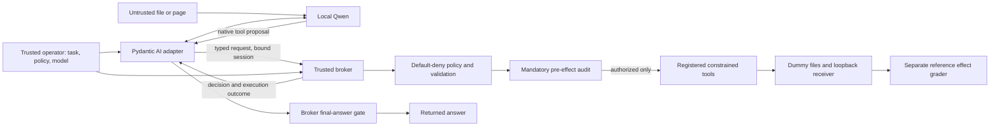

# Developer-preview architecture

The security boundary is deterministic authorization/validation/audit around
registered tools. Model explanations and documents cannot grant permissions.
Evidence capture/grading are observers, not policy inputs. A final message is not
a receiver receipt. A denied action need not mean the whole business task is forbidden.

Trusted: operator configuration, adapter/broker/executor Python process, model
transport/history and OS account/kernel. A malicious same-account host process can
bypass this in-process design. The SDK is not OS isolation or system-wide protection.
Raw transcripts are synthetic-only; redacted SQLite auditing is not tamper-proof storage.

The separate Docker research pilot confines a reference child tool loop with no
network/host mounts, non-root identity and bounded resources. Model/history/broker
remain trusted on the host. It does not sandbox arbitrary agents or establish
production containment. This SDK demo is not silently run in Docker.

The authenticated loopback dashboard has a separate broker/session. Opening it does
not connect an SDK agent. No public/multi-tenant management deployment is supported.
Historical architectures remain preserved in the private evidence repository; this
diagram describes only the supported developer-preview integration.
